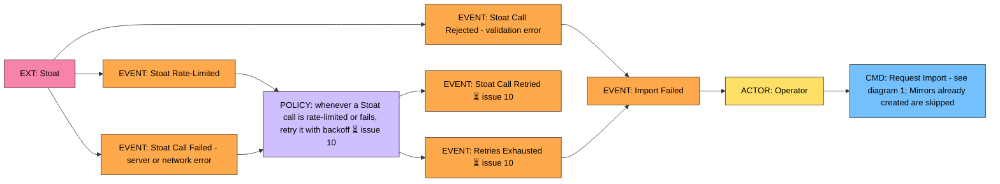

# Event Storm (Process Level)

The whole Migration as intended, not only what is built (ADR 0004: a one-time Migration, not a live Bridge). Two diagrams; paste each Mermaid block into Miro separately. They join through the **Request Import** command.

## Key

Every label starts with its sticky type, so the board reads correctly even if Miro drops the colours.

| Prefix | Sticky | Colour |
| --- | --- | --- |
| `EVENT` | Something that happened (past tense) | orange |
| `CMD` | Command: an intent to change something | blue |
| `POLICY` | Rule: "whenever X, then Y" | lilac |
| `ACTOR` | Person or clock that triggers a command | yellow |
| `EXT` | External system | pink |
| `READ MODEL` | Data a decision is made from | green |
| `HOT SPOT` | Open question or known problem | red |

✅ built today · ⏳ planned, with its GitHub issue number

## 1. Import

```mermaid
flowchart LR
    classDef event fill:#ffa94d,stroke:#333,color:#000
    classDef cmd fill:#74c0fc,stroke:#333,color:#000
    classDef policy fill:#d0bfff,stroke:#333,color:#000
    classDef actor fill:#ffe066,stroke:#333,color:#000
    classDef ext fill:#f783ac,stroke:#333,color:#000
    classDef readmodel fill:#8ce99a,stroke:#333,color:#000

    OP["ACTOR: Operator"]:::actor --> CStart["CMD: Start Migration"]:::cmd --> EStarted["EVENT: Migration Started ✅"]:::event
    EStarted --> PStartup["POLICY: whenever the Migration starts, Import ✅"]:::policy
    PStartup --> CReq["CMD: Request Import"]:::cmd

    CReq --> CSnapD["CMD: Take Discord Snapshot"]:::cmd
    CReq --> CSnapS["CMD: Take Stoat Snapshot"]:::cmd
    DISCORD["EXT: Discord"]:::ext --> CSnapD
    STOAT["EXT: Stoat"]:::ext --> CSnapS
    CSnapD --> ESnapD["EVENT: Discord Snapshot Taken ✅"]:::event --> RMD["READ MODEL: Discord Snapshot"]:::readmodel
    CSnapS --> ESnapS["EVENT: Stoat Snapshot Taken ✅"]:::event --> RMS["READ MODEL: Stoat Snapshot - which Channel Links already exist"]:::readmodel
    RMD --> EPlanned["EVENT: Import Planned ✅"]:::event
    RMS --> EPlanned

    EPlanned --> PPrivate["POLICY: whenever a Source is Private, skip it ✅"]:::policy --> ESkipPriv["EVENT: Source Skipped - private ✅"]:::event
    EPlanned --> PUnsupported["POLICY: whenever a Source is not text or voice, skip it ✅"]:::policy --> ESkipUnsup["EVENT: Source Skipped - unsupported type ✅"]:::event
    EPlanned --> PImported["POLICY: whenever a Mirror already carries the Source's Channel Link, leave it as it is ⏳ issue 21"]:::policy --> ESkipImported["EVENT: Source Skipped - already imported ⏳ issue 21"]:::event
    EPlanned --> PPrivCat["POLICY: whenever a Private Category holds a public channel, mirror it ✅"]:::policy
    EPlanned --> PNoLink["POLICY: whenever no Mirror carries the Source's Channel Link, create one ✅"]:::policy
    PPrivCat --> CCreateCat["CMD: Create Category"]:::cmd
    PNoLink --> CCreateCat
    PNoLink --> CCreateText["CMD: Create Text Channel"]:::cmd
    PNoLink --> CCreateVoice["CMD: Create Voice Channel"]:::cmd
    CCreateCat --> ECatCreated["EVENT: Mirror Category Created ✅"]:::event
    CCreateText --> ETextCreated["EVENT: Mirror Channel Created - text ✅"]:::event
    CCreateVoice --> EVoiceCreated["EVENT: Mirror Channel Created - voice ✅"]:::event

    EPlanned --> PTooLong["POLICY: whenever a Channel Description is too long, truncate and warn ✅"]:::policy --> ETrunc["EVENT: Channel Description Truncated ✅"]:::event
    EPlanned --> PNameLong["POLICY: whenever a name exceeds the Stoat limit, truncate it ⏳ issue 8"]:::policy --> ENameTrunc["EVENT: Mirror Name Truncated ⏳ issue 8"]:::event

    ECatCreated --> ECreatesDone["EVENT: Missing Mirrors Created"]:::event
    ETextCreated --> ECreatesDone
    EVoiceCreated --> ECreatesDone
    ESkipImported --> ECreatesDone
    ECreatesDone --> POrder["POLICY: once every Mirror exists, put all of them in Discord's order ⏳ issue 22"]:::policy
    POrder --> COrder["CMD: Order Mirrors"]:::cmd --> EOrdered["EVENT: Mirrors Ordered ⏳ issue 22"]:::event
    EOrdered --> ECompleted["EVENT: Import Completed ✅"]:::event
```

## 2. Stoat trouble

